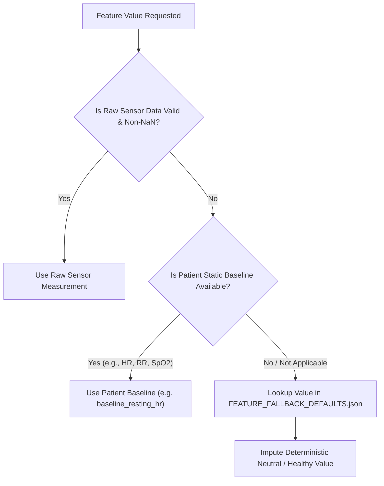

# Heuristic Fallback Integration Guide for RespiTwin v2

## 1. Overview
The RespiTwin v2 digital twin framework integrates multimodal real-time telemetry (wearables, contactless facial video analysis, acoustic respiratory bio-sensors, and environmental monitors). In live production and clinical deployments, certain sensors or camera feeds may intermittently drop out, experience network latency, or be unavailable.

Instead of rejecting inference requests or producing undefined `NaN` predictions, RespiTwin v2 applies **Deterministic Heuristic Fallbacks** to ensure **continuous, robust, and frozen forward-pass predictions**.

---

## 2. When Fallback is Triggered

Fallback logic is activated at the telemetry ingestion and window-assembly layer whenever:
1. **Missing Channel in Telemetry Packet**: An incoming time-series window does not contain one of the auto-detected dynamic feature columns.
2. **Null / NaN Values**: Sensor readings produce `NaN`, `None`, or corrupt out-of-range sensor error values.
3. **Disconnected Sensor Modality**:
   - The user disables video capture $\rightarrow$ Optical flow / rPPG / facial strain features are omitted.
   - The user is in a silent environment or disables microphone $\rightarrow$ Voice / stridor / coughing features are omitted.
   - Wearable smartwatch battery dies $\rightarrow$ PPG heart rate / HRV / step count are temporarily missing.

---

## 3. Fallback Hierarchy & Rules

The fallback value for any missing column $c$ is resolved in the following priority:



### Hierarchy Breakdown:
1. **Physiological Vitals** (`respiratory_rate_brpm`, `heart_rate_bpm`, `hrv_rmssd_ms`, `spo2`):
   - **Step A**: Query patient's static profile for personalized baseline (e.g., `patients.csv` $\rightarrow$ `baseline_resting_hr`).
   - **Step B**: If unrecorded in patient EHR, fall back to normative clinical baseline (`72 bpm` HR, `16 brpm` RR, `45 ms` HRV, `98%` SpO2).
2. **Acoustic Audio Signals** (`stridor_detection_index`, `snoring_nocturnal_score`, `hourly_cough_count`):
   - Fall back to `0.0` (indicates absence of abnormal lung sounds / neutral respiratory state).
   - Conversational metrics like `speech_rate_wpm` fall back to normal speaking cadence `140.0 wpm`.
3. **Vision / Facial Signals** (`mouth_breathing_ratio`, `nasal_flaring_index`, `brow_strain_score`, `head_bobbing_amplitude`):
   - Fall back to neutral resting facial dynamics (`0.05 - 0.15`), signifying no observable facial strain or accessory muscle recruitment.
4. **Activity Metrics** (`step_count`, `active_minutes`):
   - Fall back to `0.0` (resting/sedentary state).
5. **Environmental Readings** (`pm25_concentration`, `pm10_concentration`, `aqi_index`):
   - Fall back to moderate ambient baseline values (`PM2.5 = 15.0 µg/m³`, `PM10 = 35.0 µg/m³`, `AQI = 50.0`).

---

## 4. Implementation Code Snippet

Inference pipelines should import `FEATURE_FALLBACK_DEFAULTS.json` and apply the following lightweight pre-window imputation:

```python
import json
from pathlib import Path
import numpy as np
import pandas as pd

FALLBACK_JSON_PATH = Path(__file__).resolve().parent / "FEATURE_FALLBACK_DEFAULTS.json"
with open(FALLBACK_JSON_PATH, "r", encoding="utf-8") as f:
    FALLBACK_MAP = json.load(f)["features"]

def impute_missing_telemetry_window(
    window_df: pd.DataFrame,
    patient_profile: dict,
    required_channels: list[str]
) -> pd.DataFrame:
    """
    Ensures every required channel exists and contains zero NaNs
    by applying patient baselines or heuristic fallbacks.
    """
    df = window_df.copy()

    for col in required_channels:
        fallback_meta = FALLBACK_MAP.get(col, {})
        default_val = fallback_meta.get("default_value", 0.0)
        baseline_key = fallback_meta.get("patient_baseline_key")

        # Check if patient baseline exists
        if baseline_key and baseline_key in patient_profile and patient_profile[baseline_key] is not None:
            resolved_val = float(patient_profile[baseline_key])
        else:
            resolved_val = float(default_val)

        if col not in df.columns:
            df[col] = resolved_val
        else:
            df[col] = df[col].fillna(resolved_val)

    return df[required_channels]
```

---

## 5. Concrete Examples

### Example A: Missing Acoustic Stridor Channel
- **Scenario**: Ambient noise too high or microphone stream disconnected.
- **Trigger**: `stridor_detection_index` is missing from the data stream.
- **Fallback Resolution**: Lookup `stridor_detection_index` in `FEATURE_FALLBACK_DEFAULTS.json` $\rightarrow$ `0.0`.
- **Result**: Inference proceeds without crashing; model assumes zero inspiratory stridor.

### Example B: Missing Wearable Heart Rate
- **Scenario**: Smartwatch loose on wrist; optical photoplethysmography dropped.
- **Trigger**: `heart_rate_bpm` contains `NaN` values.
- **Fallback Resolution**: Check patient profile for `patient_profile["baseline_resting_hr"]` (e.g. `68 bpm`).
- **Result**: Window uses `68 bpm` instead of failing or biasing toward extremes.

---

## 6. Guarantee of Model Invariants
- **No Weight Updates**: Fallback values are strictly fed through the frozen inference weights.
- **Exact Vector Dimension**: Enforces that input tensors strictly match the auto-detected channel count (`21` dynamic channels, `60` static features, `270` tabular features for XGBoost, and `12` meta-features for ensemble).
