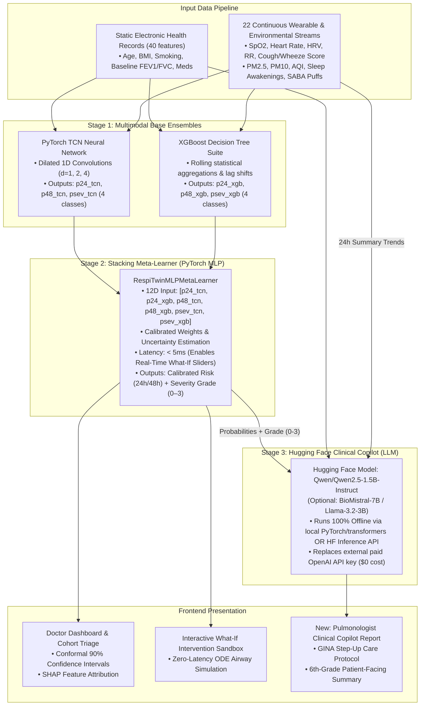

# RespiTwin / BreathTwin // Next Steps Architecture & Implementation Roadmap

> **Document Status**: Approved Engineering Specification  
> **Target Version**: v2.0 (Stacking Ensemble + Open-Source Hugging Face Clinical Copilot)  
> **Scope**: Integration of Stage-2 Meta-Learner and Stage-3 Local/Serverless Hugging Face LLM across Backend (`aasthma/`) and Frontend (`frontend/`).

---

## 1. System Architecture Overview

This roadmap upgrades BreathTwin from a Stage-1 single-neural-network system to a **Three-Stage Hierarchical Multimodal Architecture**:

---

## 2. Key Architecture Invariants

1. **Decoupling Meta-Learner from LLM**:
   * The **Meta-Learner** remains a pure numerical MLP (<5ms execution). It must **never** wait on an LLM so that What-If sliders and telemetry scrubbers remain buttery smooth at 60 fps.
   * The **LLM** acts strictly as an asynchronous downstream reasoning layer (Stage 3).
2. **Preserving the 22-Stream Telemetry Schema**:
   * The current web dashboard relies on 22 continuous and environmental streams (including $SpO_2$, $PM_{2.5}$, nocturnal awakenings, and rescue inhaler bursts). We **do not** discard these in favor of the simplified 5-stream research version; rather, the 5 core respiratory metrics are derived directly from our richer 22-stream dataset.
3. **Open-Source & Zero External API Cost**:
   * Replace `OpenAI(gpt-4o)` with open-source **`Qwen/Qwen2.5-1.5B-Instruct`** (already recorded in [`aasthma/dataset/__huggingface_repos__.json`](file:///home/casp1an/Code/DigiTwin/aasthma/dataset/__huggingface_repos__.json)) with local PyTorch execution and serverless HF endpoint fallback.

---

## 3. Backend Requirements (`aasthma/`)

### 3.1 Upgrade `InferenceEngine` to 2-Stage Stacking
* **Target File**: [`aasthma/inference/inference_engine.py`](file:///home/casp1an/Code/DigiTwin/aasthma/inference/inference_engine.py)
* **Changes**:
  1. Load both Stage-1 artifacts (`digital_twin_model.pt` + `gb_digital_twin_models.pkl`) and the Stage-2 Meta-Learner (`meta_ensemble_model.pt`).
  2. Implement feature transformation:
     * Extract normalized static features and dynamic rolling window matrices.
     * Compute Stage-1 TCN forward pass $\to (p24_{tcn}, p48_{tcn}, psev_{tcn})$.
     * Compute Stage-1 XGBoost tabular inference with lag shifts $\to (p24_{xgb}, p48_{xgb}, psev_{xgb})$.
     * Construct 12D meta-feature vector:
       $$\mathbf{x}_{\text{meta}} = [p24_{tcn}, p24_{xgb}, p48_{tcn}, p48_{xgb}, \mathbf{p}_{\text{sev}, tcn}, \mathbf{p}_{\text{sev}, xgb}]$$
     * Forward pass through `RespiTwinMLPMetaLearner` to compute final calibrated probabilities and multi-class severity (Grade 0–3).

### 3.2 Implement Hugging Face Copilot Service
* **Target File**: `aasthma/llm/copilot.py` (replaces [`updated/aasthma/llm/llm.py`](file:///home/casp1an/Code/DigiTwin/updated/aasthma/llm/llm.py))
* **Capabilities**:
  1. **Model Loading Strategy**:
     * Primary: Local lightweight execution using Hugging Face `transformers.pipeline("text-generation", model="Qwen/Qwen2.5-1.5B-Instruct")` with `torch.bfloat16` or 4-bit quantization for minimal RAM consumption (<2GB).
     * Secondary / Fallback: Serverless `huggingface_hub.InferenceClient` using optional `HF_TOKEN`.
     * Offline Fallback: Deterministic clinical rule-based engine when neither GPU nor internet is present.
  2. **Rich Telemetry Aggregation (Consuming our 22 Streams)**:
     * Aggregate 24h metrics:
       * **Acoustic / Respiratory**: Mean & peak cough severity, wheezing score, respiratory rate ($RR$).
       * **Cardiovascular & Autonomic**: Mean heart rate ($HR$), $HRV\ (RMSSD)$, and $\%$ drop in $HRV$ (acute stress).
       * **Hypoxemia**: Minimum nocturnal $SpO_2$ and cumulative desaturation minutes (<92%).
       * **Medication Burden**: Rescue inhaler ($SABA$) puffs in past 24 hours.
       * **Sleep Fragmentation**: Nocturnal awakenings and sleep interruptions.
       * **Environmental Surge**: Ambient $PM_{2.5}$ peak, $PM_{10}$, and $AQI$ category.
  3. **Structured Prompt Template**:
     * Port the senior pulmonologist persona from [`updated/aasthma/llm/info.md`](file:///home/casp1an/Code/DigiTwin/updated/aasthma/llm/info.md).
     * Output format strictly constrained to 5 JSON-parsable or clear markdown sections:
       1. *Executive Clinical Assessment*
       2. *Multi-Factor Biomarker & Environmental Attribution*
       3. *Differential Diagnosis & Rule-Outs*
       4. *GINA Step-Up Care Plan*
       5. *6th-Grade Patient-Facing Summary*

### 3.3 New FastAPI Endpoints in `aasthma/server.py`
* **Target File**: [`aasthma/server.py`](file:///home/casp1an/Code/DigiTwin/aasthma/server.py)
* **Endpoints**:
  * `GET /api/patients/{id}/copilot-report`: Returns the cached or generated clinical evaluation for the current simulation hour.
  * `POST /api/patients/{id}/copilot-report`: Generates a fresh clinical report on-demand (with streaming SSE support: `text/event-stream`).
  * `POST /api/what-if/copilot`: Generates an actionable physician/patient advisory tailored to the exact parameters of a What-If counterfactual scenario.

---

## 4. Frontend Requirements (`frontend/`)

### 4.1 New Navigation Tab: `[04] CLINICAL COPILOT & GINA REPORT`
* **Target File**: Add to [`PatientNavHeader.tsx`](file:///home/casp1an/Code/DigiTwin/frontend/components/PatientNavHeader.tsx) and create `frontend/app/patients/[id]/copilot/page.tsx`.
* **Components to Build**:
  1. **Executive Status Banner**:
     * Live badge: `CRITICAL EXACERBATION IMMINENT` / `BORDERLINE WARNING` / `STABLE BASELINE`.
     * Model consensus indicator comparing TCN (deep sequence) vs. XGBoost (tabular shift) confidence.
  2. **Biomarker & Environmental Causality Card**:
     * Visual telemetry correlation cards connecting $PM_{2.5}$ spikes $\to$ nighttime cough/wheeze $\to$ $SpO_2$ desaturation $\to$ $HRV$ drop.
  3. **Differential Diagnosis & Rule-Out Checklist**:
     * Primary Hypothesis: Acute Asthma Exacerbation vs Transient Pollution Bronchospasm.
     * Rule-Out Criteria: Viral URI (temp check), Nocturnal GERD Aspiration, Heart Failure overlap.
  4. **Interactive GINA Step-Up Treatment Card**:
     * GINA Step 1 to 5 selector with pre-filled recommendations (e.g. *"Step 3 to Step 4: Increase Budesonide/Formoterol maintenance to 2 puffs BID + add as-needed reliever"*).
     * Emergency Red-Flag Trigger checklist (Peak Flow < 50%, $SpO_2 < 90\%$, persistent tachycardia).
  5. **Empathetic Patient Summary Card**:
     * 3 simple, non-alarmist bullet points written for the patient at a 6th-grade reading level.
     * One-click "Copy Patient Instructions" or "Send SMS/WhatsApp Alert".

### 4.2 What-If Sandbox Integration
* In [`PatientWhatIfView.tsx`](file:///home/casp1an/Code/DigiTwin/frontend/components/PatientWhatIfView.tsx):
  * Add a `"Generate AI Pulmonologist Plan"` button in the Recommended Action Plan box.
  * When clicked, it passes the counterfactual inputs ($N95$, Inhaler adherence, $HEPA$, Outdoor hours) into `/api/what-if/copilot` and renders a customized physician note.

---

## 5. Implementation Phases & Task Breakdown

### Phase 1: Model & Backend Stacking Integration
- [ ] Copy `meta_ensemble_model.pt` and `gb_digital_twin_models.pkl` into `aasthma/training/ensemble/`.
- [ ] Update `aasthma/inference/inference_engine.py` to calculate both Stage-1 models and pass outputs into the Stage-2 Meta-Learner.
- [ ] Add unit test in `aasthma/tests/test_ensemble.py` verifying the 12D probability vector stacking pass.

### Phase 2: Hugging Face Copilot Integration
- [ ] Create `aasthma/llm/copilot.py` implementing `Qwen/Qwen2.5-1.5B-Instruct` loader via `transformers` and `huggingface_hub`.
- [ ] Connect our 22-stream telemetry extractor to feed the copilot prompt payload.
- [ ] Add `POST /api/patients/{id}/copilot-report` endpoint to `aasthma/server.py`.
- [ ] Test inference speed on CPU/GPU to verify response time under 3 seconds.

### Phase 3: Frontend Copilot Dashboard UI
- [ ] Add route `/patients/[id]/copilot` and tab `[04] CLINICAL COPILOT & GINA REPORT`.
- [ ] Build the GINA Guideline Step-Up cards, differential diagnosis checklist, and patient summary.
- [ ] Implement seamless Light/Dark mode styling adhering to our high-contrast design tokens.
- [ ] Add "Generate Action Plan" integration into the What-If Sandbox.

### Phase 4: End-to-End Testing & Verification
- [ ] Run full Next.js build verification (`npm run build`).
- [ ] Capture headless Chrome screenshots across Light and Dark themes.
- [ ] Test edge cases (e.g., when patient is stable vs when patient is in high-risk exacerbation).

---

## 6. Technology Stack & Dependencies

* **Deep Learning Runtime**: PyTorch 2.1+, Torchvision, Hugging Face `transformers`, `accelerate`.
* **Tree Ensemble**: XGBoost 2.0+, Scikit-Learn.
* **LLM Model**: `Qwen/Qwen2.5-1.5B-Instruct` (Apache 2.0, open-weight, low memory).
* **API Layer**: FastAPI, Pydantic v2, Uvicorn, Python-dotenv.
* **Frontend**: Next.js 16 (App Router, Turbopack), Tailwind CSS v4, Lucide React icons.
