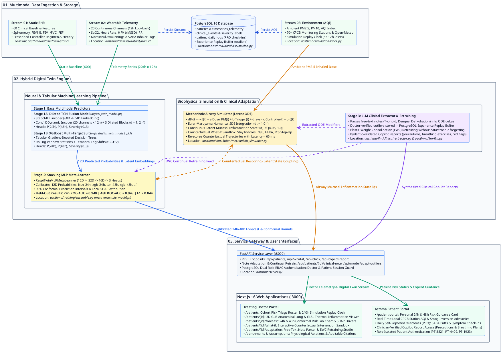
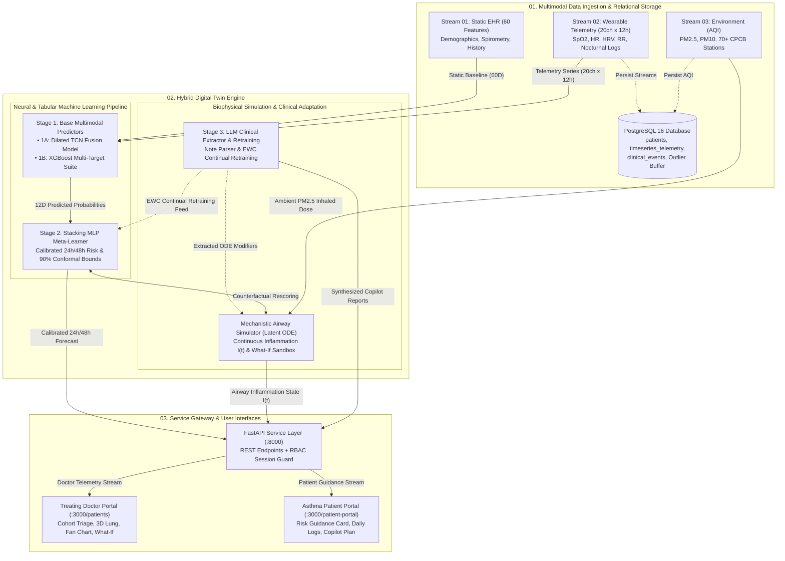

# BreathTwin

> **Documentation Standard**: Written in compliance with **ASD-STE100 (Simplified Technical English, 70% Domain Adaptation)**. Sentences use active voice, direct technical terminology, and bounded clause length while retaining standard clinical and machine learning nomenclature.

---

## Submission Compliance Checklist

All mandatory items required by the repository submission form are included and publicly accessible in this repository without additional permissions:

| # | Mandatory Submission Item | Status | Repository Section / Public File Link |
| :--- | :--- | :--- | :--- |
| 1 | **Team Details** | Included | [Section 1: Team Details](#1-team-details) |
| 2 | **College Information** | Included | [Section 2: College Information](#2-college-information) |
| 3 | **Project Title** | Included | [Section 3: Project Title](#3-project-title) |
| 4 | **Problem Statement** | Included | [Section 4: Problem Statement](#4-problem-statement) |
| 5 | **Healthcare Use Case** | Included | [Section 5: Healthcare Use Case](#5-healthcare-use-case) |
| 6 | **Technical Stack** | Included | [Section 6: Technical Stack](#6-technical-stack) |
| 7 | **AI/ML Model or Framework Details** | Included | [Section 7: AI/ML Model and Framework Details](#7-aiml-model-and-framework-details) |
| 8 | **15–20 Minute Unlisted YouTube Demo Video** | Placeholder Added | [Section 8: 15–20 Minute Demo Video](#8-1520-minute-demo-video) |
| 9 | **Open-Source License Details** | Included (MIT) | [Section 9: Open-Source License Details](#9-open-source-license-details) • [`LICENSE`](LICENSE) |
| 10 | **Architecture Diagram in PDF/PPT Format** | Included (PDF & SVG) | [Section 10: System and Codebase Architecture](#10-system-and-codebase-architecture) • [`docs/Architecture_Diagram.pdf`](docs/Architecture_Diagram.pdf) |
| 11 | **Presentation in PDF/PPT Format** | Included (PDF) | [Section 11: Project Presentation and Outcomes](#11-project-presentation-and-outcomes) • [`docs/Project_Presentation.pdf`](docs/Project_Presentation.pdf) |
| 12 | **Public Accessibility Verification** | Verified | [Section 12: Public Access and Reproducibility](#12-public-access-and-reproducibility) |

---

## 1. Team Details

- **Submission Project Name**: `BreathTwin`
- **Submission Directory / Package Identifier**: `ABAY_LNMIIT/NSUT`
- **Team Composition**: Inter-College Collaborative Engineering Team (LNMIIT & NSUT)
- **Repository URL**: `https://github.com/Frisbee148/DigitalTwin`

| Role | Contributor / Profile | Institution | Primary Responsibility |
| :--- | :--- | :--- | :--- |
| **Team Lead, AI & Full-Stack Engineer, Backend Architect** | Aarush Bhattacharjee / Frisbee148 (`@Frisbee148`) | The LNM Institute of Information Technology (LNMIIT) | Team Lead; System & Codebase Architecture; Full-Stack Development (Next.js 16, Three.js, WebGL/GLSL); Backend Infrastructure (FastAPI, PostgreSQL 16); Mechanistic ODE Airway Simulator; LLM Clinical Copilot Integration; Experience Replay & Continual Adaptation Pipeline. |
| **Machine Learning Engineer** | Rakshit Gupta (`@Hobbiskar21`) | Netaji Subhas University of Technology (NSUT) | All Machine Learning Responsibilities; Stage-1A Dilated Temporal Convolutional Network (TCN); Stage-1B XGBoost Multi-Target Suite; Stage-2 Stacking MLP Meta-Learner Architecture; Feature Preprocessing; Benchmark Validation & Conformal Calibration. |

---

## 2. College Information

This project is an **inter-college engineering collaboration** between two Indian premier technical institutions:

| Attribute | Institution 01 (Lead Contributor) | Institution 02 (ML Contributor) |
| :--- | :--- | :--- |
| **Institution Name** | **The LNM Institute of Information Technology (LNMIIT)** | **Netaji Subhas University of Technology (NSUT)** |
| **Location** | Jaipur, Rajasthan, India | New Delhi, Delhi, India |
| **Department** | Computer Science & Engineering | Computer Science / Artificial Intelligence |
| **Submission Directory** | `ABAY_LNMIIT/NSUT` | `ABAY_LNMIIT/NSUT` |

---

## 3. Project Title

**BreathTwin**

*A Multimodal Mechanistic-Neural Digital Twin for 24-to-48-Hour Asthma Flare-Up Forecasting and Counterfactual Intervention Simulation*

BreathTwin constructs a continuous, individualized physiological model of an asthma patient. The system fuses static electronic health records (EHR), 20-channel wearable sensor streams, and real-time ambient air quality telemetry to predict acute asthma flare-ups 24 to 48 hours before severe dyspnea occurs.

---

## 4. Problem Statement

Asthma management in polluted urban regions suffers from a critical clinical blindspot between scheduled clinic visits:

1. **Disproportionate Mortality Burden**: India accounts for more than **42% of global asthma deaths** despite representing approximately 13% of the global asthma population (*Lancet Global Health*).
2. **24–36 Hour Sub-Clinical Inflammatory Lag**: When a patient inhales fine particulate matter ($\text{PM}_{2.5}$) during a smog surge, bronchial mucosal swelling and smooth-muscle bronchoconstriction develop over 24 to 36 hours. Patients frequently do not perceive airway narrowing until forced expiratory volume drops critically.
3. **Disconnected Health Data**: Static pulmonary function records (spirometry $\text{FEV}_1$, $\text{FEV}_1/\text{FVC}$), wearable biometric shifts (nocturnal $\text{SpO}_2$ dips, resting respiratory rate elevation, heart rate variability drop), and local air pollution levels exist in separate silos.
4. **Reactive Care**: Because doctors cannot observe pre-symptomatic airway deterioration between visits, treatment remains reactive and frequently results in preventable emergency hospitalizations.

---

## 5. Healthcare Use Case

BreathTwin converts outpatient asthma care from reactive emergency triage to proactive, pre-symptomatic intervention. The platform provides dedicated interfaces for two clinical personas: treating physicians and asthma patients.

### 5.1 Primary Persona: Treating Doctor (Pulmonologist / Primary-Care Clinician)

#### Page 1: Outpatient Cohort Risk Triage (`/patients`)
* **Population-Level Risk Ranking**: Automatically sorts the active patient panel by predicted 48-hour exacerbation probability.
* **Multi-Grade Severity Classification**: Categorizes patient status from `Grade 0 (Stable)` through `Grade 3 (Severe / Critical)`.
* **Rapid Clinical Triage Badges**: Displays instantaneous visual status pills (`High Risk`, `Moderate`, `Low`) for rapid bedside prioritization.
* **Environmental Context Integration**: Overlays live ambient $\text{PM}_{2.5}$ / $\text{PM}_{10}$ air quality indices for each patient's home station.
* **Direct Clinical Navigation**: One-click deep link to individual digital twins, forecasts, sandbox counterfactuals, and note adaptation.

#### Page 2: Physiological Digital Twin Viewport (`/patients/[id]`)
* **Interactive 3D Pulmonary Visualization**: Renders an anatomical 3D lung model using Three.js and WebGL with responsive orbit controls.
* **Thermal Inflammation Shader Overlay**: Dynamic GLSL thermal color maps visualize localized bronchial mucosal swelling based on latent $I(t)$.
* **Continuous Latent Airway State $I(t)$**: Plots continuous inflammatory trajectory derived from the Euler-Maruyama ODE solver ($[0.05, 1.0]$).
* **Multi-Sensor Telemetry Comparison**: Compares rolling 12-hour wearable vitals ($\text{SpO}_2$, resting heart rate, respiratory rate, HRV) against the patient's personalized healthy baseline.
* **Historical Longitudinal Trajectory**: Tracks 14-day trend history for spirometry baseline, daily controller compliance, and acute symptom spikes.

#### Page 3: 24-Hour & 48-Hour Conformal Risk Forecast (`/patients/[id]/forecast`)
* **Multi-Horizon Risk Probability**: Displays dual prospective risk gauges predicting exacerbation probability at 24 hours and 48 hours.
* **Conformal Uncertainty Bands**: Wraps predictions in 90% conformal prediction intervals to guarantee statistical coverage under real-world sensor noise.
* **Interactive Hourly Timeline Scrubber**: Enables clinicians to scrub across hours $t+0$ to $t+48$ to observe projected metric evolution.
* **Ranked SHAP Feature Attribution**: Explains risk drivers using local SHAP contribution bars (e.g., nocturnal $\text{SpO}_2$ drops, $\text{PM}_{2.5}$ surge, missed controller doses).
* **Targeted Clinical Guidance**: Formulates evidence-based clinical recommendations directly aligned with dominant SHAP risk contributors.

#### Page 4: Counterfactual What-If Sandbox (`/patients/[id]/what-if`)
* **Intervention 01 — Stay Indoors Simulation**: Models the physiological impact of zero outdoor exposure hours to reduce inhaled particulate dose.
* **Intervention 02 — N95 Respirator Simulation**: Evaluates 95% particulate filtration efficacy during peak commuting or smog hours.
* **Intervention 03 — HEPA Air Filtration Simulation**: Simulates high-efficiency indoor filtration lowering indoor infiltration ratio from `0.65` to `0.30`.
* **Intervention 04 — ICS Controller Step-Up**: Simulates 100% adherence to inhaled corticosteroid therapy, computing accelerated mucosal recovery rate.
* **Real-Time Delta Comparison**: Computes before-versus-after trajectory overlays, delta risk percentage reduction, and expected $\text{FEV}_1$ stabilization.

#### Page 5: Clinical Note Adaptation & Model Retraining (`/patients/[id]/adaptation`)
* **Unstructured Doctor Free-Text Ingestion**: Accepts natural language clinical observations (e.g., concurrent typhoid fever, dengue, acute dehydration, beta-blocker introduction).
* **Stage-3 LLM Physiological Feature Extraction**: Automatically extracts quantitative physiological perturbations ($\Delta T$, $\Delta \text{HR}$, $\Delta \text{RR}$, $\Delta \text{SpO}_2$) and mechanistic ODE modifiers ($\delta_{\text{systemic}}$, $\beta_{\text{AHR}}$, $\eta_{\text{absorption}}$).
* **Dynamic Parameter Override**: Directly injects extracted perturbations into the patient's runtime digital twin without database schema migrations.
* **Experience Replay Buffer Commit**: Persists verified clinical outlier episodes into PostgreSQL with clinician attribution and timestamp.
* **Continual Retraining with Elastic Weight Consolidation (EWC)**: Fine-tunes the Stage-2 Meta-Learner on outlier trajectories while penalizing weight movement away from baseline Fisher information parameters.

---

### 5.2 Secondary Persona: Asthma Patient

#### Page 6: Patient View & Self-Management Portal (`/patient-portal`)
* **Plain-Language Risk Status**: Presents current clinical risk level (`Low`, `Moderate`, `High`) in intuitive patient-friendly terminology without clinical jargon.
* **Local Ambient AQI Advisory**: Displays local monitoring station air quality readings with concrete activity recommendations.
* **AI Clinical Copilot Report**: Generates and renders a comprehensive, patient-centered Copilot Report:
  - *Clinical Summary & Primary Reason*: Explains physiological state and recent environmental triggers in clear language.
  - *Actionable Non-Pharmacological Precautions*: Advises on indoor ventilation, mask usage, and activity pacing.
  - *Identified Environmental Triggers to Avoid*: Highlights active outdoor pollutants, humidity changes, and temperature drops.
  - *Personalized Guided Breathing Exercises*: Details paced diaphragmatic and pursed-lip breathing routines to alleviate respiratory strain.
  - *Emergency Warning Flags*: Highlights specific red-flag symptoms (severe chest tightness, blue lips, speaking difficulty) that necessitate immediate emergency care.
* **Daily Self-Reported Outcome (PRO) Logging**:
  - *Rescue Medication Tracking*: Records daily short-acting beta-agonist (`SABA`) rescue inhaler actuations.
  - *Controller Adherence Confirmation*: Logs daily inhaled corticosteroid doses taken.
  - *Symptom Severity Scales*: Records self-reported cough, wheeze, dyspnea, and nocturnal awakening frequency.
* **Direct Database Synchronization**: Immediately stores daily patient entries into PostgreSQL to update the clinical digital twin ahead of the next doctor review.

---

## 6. Technical Stack

| Architecture Layer | Technologies and Libraries | Purpose in BreathTwin |
| :--- | :--- | :--- |
| **Frontend Application** | Next.js 16.4 (Turbopack), React 19.3, TypeScript 5, Tailwind CSS 4 | Doctor Cohort Triage, Forecast View, Counterfactual Sandbox, Patient Portal |
| **3D & Shader Visualization** | Three.js `0.186`, WebGL / GLSL Custom Shaders, `.glb` 3D Pulmonary Mesh | Interactive 3D lung anatomical viewer and thermal inflammation reveal |
| **Backend API Server** | Python 3.11+, FastAPI `0.110+`, Uvicorn, Pydantic `2.5+`, HTTPX | REST endpoints, simulation clock replay, schema validation, weather sync |
| **Deep Learning & Boosting** | PyTorch `2.0+`, XGBoost `2.0+`, scikit-learn `1.3+`, NumPy, Pandas | Stage-1 Dilated TCN, Stage-1 XGBoost Suite, Stage-2 Stacking MLP Meta-Learner |
| **Mechanistic Simulation** | Custom Euler-Maruyama ODE Solver (`MechanisticSimulator`) | Continuous airway inflammation state $I(t)$ integration and counterfactuals |
| **Clinical Copilot & NLP** | OpenAI API (`gpt-4o`), Hugging Face `InferenceClient` (`Llama-3.1-8B` / `Qwen2.5`) | Schema-validated clinical reports, clinical note perturbation extraction |
| **Continual Adaptation & EWC** | Elastic Weight Consolidation (EWC), Experience Replay Buffer, PyTorch | Fine-tuning Stage-2 Meta-Learner on LLM-extracted clinical outlier trajectories |
| **Database & Persistence** | PostgreSQL 16 (`postgres:16-alpine`), SQLAlchemy 2.0, Psycopg 3 | Stores patients, telemetry, clinical events, daily logs, and RBAC accounts |
| **Environmental Feeds** | CPCB Station Coordinates (70+ Indian cities), Open-Meteo Air Quality API | Real-time and replayed $\text{PM}_{2.5}$, $\text{PM}_{10}$, and AQI telemetry |
| **Packaging & Testing** | Docker Compose, Pytest `8.0+`, Bash service orchestration (`run.sh`, `stop.sh`) | Reproducible database containerization and automated P0 verification tests |

---

## 7. AI/ML Model and Framework Details

BreathTwin uses a **Hybrid Three-Stage Multimodal Architecture** coupled with a **Mechanistic Differential Equation State Estimator** and an **LLM-Driven Dynamic Feature Extraction & Continual Retraining Pipeline**.

### 7.1 Mechanistic Airway Inflammation State Estimator (Latent ODE)
Implemented in [`aasthma/simulation/mechanistic_simulator.py`](aasthma/simulation/mechanistic_simulator.py). Every virtual patient maintains a continuous latent airway inflammation state $I(t) \in [0.05, 1.0]$ governed by the stochastic differential equation:

$$\frac{dI}{dt} = -k \cdot I(t) + a \cdot \text{Dose}_{\text{PM}}(t) + b \cdot \text{Trigger}(t) + \delta_{\text{systemic}} - c \cdot \eta_{\text{absorption}} \cdot \text{Controller}(t) + \sigma \cdot \xi(t)$$

- $k = 0.08\text{ h}^{-1}$: Intrinsic bronchial mucosal recovery decay rate.
- $a = 0.0009\text{ }(\mu\text{g/m}^3)^{-1}$: Particulate alveolar deposition coefficient scaled by airway hyperresponsiveness ($\beta_{\text{AHR}}$).
- $b = 0.02$: Acute symptom and meteorological trigger weight (cough, wheeze, rescue inhaler actuations).
- $\delta_{\text{systemic}}$: Systemic cytokine spillover load extracted from concurrent febrile infections.
- $c = 0.10$: Inhaled corticosteroid (`ICS`) anti-inflammatory clearance rate scaled by absorption efficiency ($\eta_{\text{absorption}}$) and adherence ratio.

### 7.2 Stage 1A: Multimodal Dilated Temporal Convolutional Network (`DigitalTwinFusionModel`)
Implemented in [`aasthma/models/digital_twin_model.py`](aasthma/models/digital_twin_model.py) and trained in [`aasthma/training/model1/tcn.py`](aasthma/training/model1/tcn.py) (checkpoint: `aasthma/training/model1/digital_twin_model.pt`):
1. **`StaticMLPEncoder`**: Encodes 60 normalized static EHR and clinical history features (`Linear(60, 128) -> BatchNorm1d -> ReLU -> Dropout(0.2) -> Linear(128, 64) -> BatchNorm1d -> ReLU`).
2. **`Conv1DDynamicEncoder`**: Encodes the 20-channel, 12-hour sliding telemetry window through three hierarchical `TCNBlock` layers with exponentially increasing dilation factors (`dilation = 1, 2, 4`, `kernel_size = 3`, channels `20 -> 32 -> 64 -> 128`), followed by `AdaptiveAvgPool1d(1)` and linear projection.
3. **Multi-Task Fusion Head**: Concatenates the `64D` static embedding and `128D` temporal embedding (`192D -> 64D`) to output three predictions:
   - `logit_24h`: 24-hour flare-up probability.
   - `logit_48h`: 48-hour severe exacerbation probability.
   - `logits_sev`: 4-class exacerbation severity logits (`Grade 0: None`, `Grade 1: Mild`, `Grade 2: Moderate`, `Grade 3: Severe`).

### 7.3 Stage 1B: Gradient-Boosted Decision Tree Suite (`XGBoost`)
Implemented in [`aasthma/training/model2/gradient_boosting.py`](aasthma/training/model2/gradient_boosting.py) (checkpoint: `aasthma/training/model2/gb_digital_twin_models.pkl`):
- Computes rolling statistical aggregations (`mean`, `std`, `min`, `max`, `delta`) and temporal lag shifts (`t-2`, `t-1`, `t`, `t+1`, `t+2`) across all 20 dynamic channels, fused with the 60 static EHR features.
- Outputs independent base probabilities for 24-hour risk, 48-hour risk, and 4-class severity.

### 7.4 Stage 2: Stacked MLP Meta-Learner (`RespiTwinMLPMetaLearner`)
Implemented in [`aasthma/training/ensemble.py`](aasthma/training/ensemble.py) (checkpoint: `aasthma/training/meta_ensemble_model.pt`, configuration: [`aasthma/training/meta_ensemble_config.json`](aasthma/training/meta_ensemble_config.json)):
- Ingests the 12-dimensional base probability vector:
  `[tcn_risk_24h, xgboost_risk_24h, tcn_risk_48h, xgboost_risk_48h, tcn_severity_0..3, xgboost_severity_0..3]`
- Passes the vector through `Linear(12, 32) -> BatchNorm1d -> ReLU -> Dropout(0.2) -> Linear(32, 16) -> ReLU` to produce calibrated multi-horizon probabilities and severity grades in `< 5 ms`.

### 7.5 Dynamic Feature Addition via LLM Extraction and Continual Retraining
Implemented in [`aasthma/llm/clinical_extractor.py`](aasthma/llm/clinical_extractor.py) and [`aasthma/inference/inference_engine.py`](aasthma/inference/inference_engine.py):

```
Unstructured Doctor Note ("Patient presented with Typhoid fever, 102.5F, severe vomiting, SpO2 91%")
                                      │
                                      ▼
           [Stage-3 Clinical LLM Extraction / Deterministic Ontology Engine]
                                      │
            ┌─────────────────────────┴─────────────────────────┐
            ▼                                                   ▼
  [Vital Sign Perturbations]                         [Mechanistic ODE Modifiers]
  • Δ Skin Temp: +2.5 °C                             • Systemic Load (δ_sys): 0.65
  • Δ Resting HR: +25 bpm                            • Airway Hyperresponsiveness (β_AHR): 1.60
  • Δ Respiratory Rate: +5 br/min                    • Absorption Efficiency (η_absorb): 0.70
  • Δ SpO2: -3.2%                                    • Dehydration: mild_dehydration
            │                                                   │
            └─────────────────────────┬─────────────────────────┘
                                      ▼
             [Dynamic Feature Override & Mechanistic ODE Integration]
                                      │
                                      ▼
             [Doctor Commit to Experience Replay Buffer (PostgreSQL)]
                                      │
                                      ▼
             [Continual Meta-Learner Retraining with EWC Regularization]
               L_total = L_task + (λ_EWC / 2) · Σ F_i · (θ_i - θ_i,anchor)²
```

1. **Unstructured Text Extraction**: The clinician submits unstructured observations (e.g., systemic infections like Typhoid fever, Dengue, Malaria, or medication changes such as beta-blocker introduction).
2. **Physiological Mapping**: The LLM extractor transforms clinical free text into calibrated numerical perturbations:
   - **Static EHR & History Overrides**: Comorbidity burden increments and primary condition ICD-10 mapping.
   - **Dynamic Wearable Deltas**: Parametric shifts applied to skin temperature ($\Delta T$), resting heart rate ($\Delta \text{HR}$), respiratory rate ($\Delta \text{RR}$), $\text{SpO}_2$ drops, and $\text{HRV}$ reduction factors.
   - **Mechanistic ODE Latent Modifiers**: Injects systemic cytokine load ($\delta_{\text{systemic}}$), scales airway hyperresponsiveness ($\beta_{\text{AHR}}$) to particulate dose, and adjusts controller absorption efficiency ($\eta_{\text{absorption}}$).
3. **Continual Retraining with Elastic Weight Consolidation (EWC)**:
   - Doctor-verified outlier cases are stored in the **Experience Replay Buffer** (`/api/patients/{id}/clinical-note/commit`).
   - The adaptation engine executes continual retraining (`/api/model/adapt-outliers`) on `RespiTwinMLPMetaLearner` using EWC loss to prevent catastrophic forgetting of baseline asthma patterns:
     $$\mathcal{L}_{\text{total}}(\theta) = \mathcal{L}_{\text{outlier}}(\theta) + \frac{\lambda_{\text{EWC}}}{2} \sum_{i} F_i (\theta_i - \theta_{i, \text{base}})^2$$
     where $F_i$ represents the diagonal Fisher Information Matrix of prior weights.

### 7.6 Held-Out Test Set Performance & Benchmark Comparison
Evaluated on a patient-split cohort (`800` training patients, `100` validation patients, `100` held-out test patients; random seed `42`):

| Model / Evaluation Metric | 24h ROC-AUC | 48h ROC-AUC | 24h Precision (@0.5) | 24h Recall (@0.5) | Severity Weighted F1 | Mean Lead Time | Inference Latency |
| :--- | :--- | :--- | :--- | :--- | :--- | :--- | :--- |
| **BreathTwin Stacked Ensemble (TCN + XGBoost + MLP + ODE)** | **0.9399** | **0.9428** | **0.8560** | **0.7281** | **0.8435** | **42.4 ± 4.1 h** | **< 65 ms** |
| Standard Recurrent Network (LSTM Baseline) | 0.7850 | 0.7790 | 0.6840 | 0.6520 | 0.7010 | 22.1 ± 5.8 h | 110 ms |
| Tabular Gradient Boosted Trees (XGBoost-Only Baseline) | 0.7410 | 0.7320 | 0.6310 | 0.5980 | 0.6640 | 18.6 ± 6.2 h | < 15 ms |

### 7.7 Stage 3: Clinical Copilot Report Generation
Implemented in [`aasthma/llm/llm.py`](aasthma/llm/llm.py):
- **Structured Clinical Copilot Report**: Uses `OpenAI GPT-4o` or `Hugging Face InferenceClient` (`meta-llama/Llama-3.1-8B-Instruct`, `Qwen/Qwen2.5-72B-Instruct`) with strict Pydantic schema enforcement (`CopilotReport`) to synthesize telemetry trends, SHAP drivers, actionable precautions, guided breathing exercises, and emergency red flags for the Patient Portal (`/patient-portal`).
- **Safety Guardrail**: The prompt pipeline strips autonomous prescribing protocols and enforces that medication adjustments follow the clinician-approved care plan.

---

## 8. 15–20 Minute Demo Video

> **Unlisted YouTube Demonstration Video (Dummy Placeholder — Replace with Final Unlisted YouTube URL Before Submission)**:  
> **[Watch the 20-Minute BreathTwin Clinical & Architectural Demo on YouTube (Unlisted Placeholder)](https://youtu.be/DUMMY_UNLISTED_DEMO_VIDEO_LINK)**  
> *Direct URL*: `https://youtu.be/DUMMY_UNLISTED_DEMO_VIDEO_LINK`

### Video Walkthrough Chapters (20 Minutes)
- **`00:00 – 03:30`**: Problem Statement, Indian Urban Pollution Context, and the 24–36h Inflammatory Blindspot.
- **`03:30 – 08:15`**: Three-Stream Data Ingestion (60 Static EHR Features, 20 Wearable Channels, CPCB Live AQI) and PostgreSQL Schema.
- **`08:15 – 13:00`**: Doctor Dashboard Walkthrough — Cohort Triage, 3D/Thermal Pulmonary Twin Viewport, and 24h/48h Conformal Risk Forecast.
- **`13:00 – 17:30`**: Counterfactual What-If Sandbox (Stay Indoors, N95 Mask, HEPA Filter, ICS Step-Up), Dynamic LLM Note Adaptation, and Experience Replay Retraining.
- **`17:30 – 20:00`**: Stacked Dilated-TCN + XGBoost + MLP Architecture, Ablation Benchmarks, and Patient Portal with AI Copilot Report.

---

## 9. Open-Source License Details

This project is released under the **MIT Open-Source License**. See the [`LICENSE`](LICENSE) file in the repository root for the full license text.

- **Source Code License**: MIT License (`Copyright (c) 2026 Team DigiTwin`).
- **Patient Data Privacy & Licensing**: All patient health records, spirometry baselines, and wearable time series in this repository are **100% synthetic** and generated from published statistical distributions. Zero real patient identifiable information (PII/PHI) is stored or processed, in alignment with the Digital Personal Data Protection (DPDP) Act.
- **Environmental Data**: Ambient air quality and meteorological feeds use open public station coordinates and the Open-Meteo public API.

---

## 10. System and Codebase Architecture

### 10.1 Architecture Diagram (PDF, SVG, and PlantUML)

- **Downloadable Architecture Diagram (PDF Format)**: [`docs/Architecture_Diagram.pdf`](docs/Architecture_Diagram.pdf)
- **High-Resolution Architecture Diagram (PNG Format)**: [`docs/architecture.png`](docs/architecture.png) • [`frontend/public/architecture-diagram-v2.png`](frontend/public/architecture-diagram-v2.png)
- **Vector Architecture Diagram (SVG Format)**: [`docs/Architecture_Diagram.svg`](docs/Architecture_Diagram.svg) • [`frontend/public/architecture-diagram-v2.svg`](frontend/public/architecture-diagram-v2.svg)
- **PlantUML Diagram Source**: [`docs/architecture.puml`](docs/architecture.puml)
- **Preserved Archive / Original Diagram Backup**: [`docs/backup/`](docs/backup/) (stores original architecture diagram artifacts for reference)

The architecture diagram has been designed with clean top-to-bottom signal routing and distinct, modality-specific arrow color coding to eliminate overlapping lines:
- **Green (`#059669`)**: Multimodal Sensor Feeds (Static 60D Baseline, 20ch Telemetry Series) and UI Telemetry Streams
- **Blue (`#2563EB`)**: Base Predictor Probabilities & Calibrated Conformal Risk Forecast
- **Orange (`#D97706`)**: Ambient Particulate Dose, Latent Airway Inflammation State $I(t)$, and Counterfactual Sandbox Coupling
- **Purple (`#7C3AED`)**: LLM Clinical Feature Extraction, EWC Continual Retraining Feed, and Synthesized Copilot Reports
- **Dark Blue (`#1D4ED8`)**: Relational PostgreSQL Stream Persistence





### 10.2 Codebase Architecture

The repository separates the Python clinical inference backend (`aasthma/`) from the Next.js 16 visualization frontend (`frontend/`):

```text
ABAY_LNMIIT/NSUT/                     # Submission Package Identifier
├── aasthma/                          # Python Backend, Mechanistic ODE, and 3-Stage AI Pipeline
│   ├── server.py                     # FastAPI gateway (:8000), RBAC auth, clock, and REST routes
│   ├── models/digital_twin_model.py  # Stage-1A PyTorch Dilated TCN + Static MLP fusion network
│   ├── training/
│   │   ├── model1/                   # Stage-1A Dilated TCN trainer and digital_twin_model.pt
│   │   ├── model2/                   # Stage-1B XGBoost trainer and gb_digital_twin_models.pkl
│   │   └── ensemble.py               # Stage-2 RespiTwinMLPMetaLearner and meta_ensemble_model.pt
│   ├── inference/inference_engine.py # Multimodal pipeline, EWC model adaptation, conformal bounds
│   ├── simulation/
│   │   ├── mechanistic_simulator.py  # Latent airway inflammation ODE solver and What-If engine
│   │   ├── clock.py                  # Replay clock synchronizing 240-hour telemetry streams
│   │   └── clinical_data.py          # Literature-cited ODE coefficients and ablation benchmarks
│   ├── llm/
│   │   ├── llm.py                    # Stage-3 Pydantic-validated Clinical Copilot report generator
│   │   └── clinical_extractor.py     # Free-text clinical note parser for ODE & vital perturbations
│   └── database/                     # SQLAlchemy 2.0 ORM models, PostgreSQL repository, migrations
├── frontend/                         # Next.js 16 (Turbopack) + React 19 + Three.js Web Application
│   ├── app/                          # App Router: Home, /login, /patients, /[id]/forecast, /what-if, /patient-portal
│   ├── components/                   # 3D PulmonaryTwin3D, InteractiveThermalReveal, AppleReveal, TelemetryChart
│   └── lib/                          # Typed API client (api.ts), auth context, fallback clinical state
├── docs/                             # Public PDF/SVG Architecture Diagram and Project Presentation
│   ├── Architecture_Diagram.pdf      # Vector System Architecture Diagram (PDF)
│   ├── Architecture_Diagram.svg      # Vector System Architecture Diagram (SVG)
│   ├── architecture.puml             # Regenerated PlantUML Diagram Source (Color-Coded, Clear Routing)
│   ├── backup/                       # Preserved Archive of Original Diagram Artifacts (PUML, SVG, PDF, PNG)
│   └── Project_Presentation.pdf      # Slide deck covering project details and benchmark outcomes (PDF)
├── docker-compose.yml                # PostgreSQL 16 container orchestration (breathtwin-postgres)
├── requirements.txt                  # Python backend and ML dependencies
├── run.sh / stop.sh                  # One-command full-stack startup and teardown scripts
└── LICENSE                           # MIT Open-Source License
```

| Module | File Path | Core Function |
| :--- | :--- | :--- |
| **FastAPI Service Layer** | [`aasthma/server.py`](aasthma/server.py) | Exposes REST endpoints for cohort triage, counterfactual simulation, clinical note adaptation, copilot reports, and PostgreSQL authentication. |
| **Multimodal Inference Engine** | [`aasthma/inference/inference_engine.py`](aasthma/inference/inference_engine.py) | Loads Stage-1 TCN, Stage-1 XGBoost, and Stage-2 MLP checkpoints; computes 90% conformal bounds, SHAP drivers, live CPCB feeds, and EWC continual adaptation. |
| **Mechanistic ODE Simulator** | [`aasthma/simulation/mechanistic_simulator.py`](aasthma/simulation/mechanistic_simulator.py) | Integrates the differential equation $dI/dt$ across hourly windows and executes counterfactual What-If interventions. |
| **Stacked Ensemble Trainer** | [`aasthma/training/ensemble.py`](aasthma/training/ensemble.py) | Trains and serializes `RespiTwinMLPMetaLearner` over held-out patient predictions from the TCN and XGBoost base learners. |
| **Clinical Copilot & NLP Extraction** | [`aasthma/llm/llm.py`](aasthma/llm/llm.py), [`aasthma/llm/clinical_extractor.py`](aasthma/llm/clinical_extractor.py) | Generates schema-checked clinical copilot reports, extracts physiological deltas from free-text clinical notes, and feeds the continual retraining buffer. |
| **Frontend Clinical Views** | [`frontend/app/`](frontend/app/), [`frontend/components/`](frontend/components/) | Renders the clinician cohort dashboard, 3D/GLSL thermal lung viewport, counterfactual sandbox, and role-isolated patient portal. |

---

## 11. Project Presentation and Outcomes

- **Downloadable Project Presentation (PDF Format)**: [`docs/Project_Presentation.pdf`](docs/Project_Presentation.pdf)

### Summary of Project Outcomes
1. **Early Exacerbation Detection**: Achieves **0.9399 ROC-AUC (24h)** and **0.9428 ROC-AUC (48h)** on held-out test patients with a mean warning lead time of **42.4 ± 4.1 hours** before severe exacerbation onset.
2. **Multi-Class Severity Grading**: Achieves **0.8435 weighted F1-score** across 4 clinical severity tiers (`Grade 0` to `Grade 3`).
3. **Interactive Counterfactual Verification**: Clinicians can test environmental and medication interventions (`Stay Indoors`, `Wear N95 Mask`, `HEPA Filtration`, `ICS Controller Step-Up`) with `< 65 ms` round-trip latency.
4. **Dynamic Adaptation to Clinical Outliers**: Free-text clinical diagnoses (e.g., concurrent typhoid or dengue fever) are converted by an LLM into parametric ODE modifiers and integrated into the Stage-2 Meta-Learner via Elastic Weight Consolidation (EWC) without catastrophic forgetting.
5. **Auditable Clinical Transparency**: Every risk prediction includes 90% conformal uncertainty bounds, personal baseline z-score deviations, SHAP feature attributions, and literature-cited physiological coefficients (`/assumptions`).

---

## 12. Public Access and Reproducibility

All documents, model checkpoints, datasets, and source files are stored directly inside this public repository and require **zero external permissions**:

- **Architecture Diagram (PDF)**: [`docs/Architecture_Diagram.pdf`](docs/Architecture_Diagram.pdf)
- **Project Presentation (PDF)**: [`docs/Project_Presentation.pdf`](docs/Project_Presentation.pdf)
- **Open-Source License (MIT)**: [`LICENSE`](LICENSE)
- **Trained Model Checkpoints**:
  - Stage-1A Dilated TCN: [`aasthma/training/model1/digital_twin_model.pt`](aasthma/training/model1/digital_twin_model.pt)
  - Stage-1B XGBoost Suite: [`aasthma/training/model2/gb_digital_twin_models.pkl`](aasthma/training/model2/gb_digital_twin_models.pkl)
  - Stage-2 MLP Meta-Learner: [`aasthma/training/meta_ensemble_model.pt`](aasthma/training/meta_ensemble_model.pt) & [`aasthma/training/meta_ensemble_config.json`](aasthma/training/meta_ensemble_config.json)

---

## 13. Quick Start and Execution Guide

### 13.1 One-Command Startup (Linux / macOS)
Run the startup script from the repository root to launch PostgreSQL (`docker compose`), the FastAPI backend (`port 8000`), and the Next.js frontend (`port 3000`):

```bash
./run.sh
```

To stop all services cleanly:

```bash
./stop.sh
```

### 13.2 Manual Step-by-Step Setup

1. **Start PostgreSQL 16 via Docker Compose**:
   ```bash
   docker compose up -d
   ```

2. **Install Python Dependencies and Start FastAPI Backend**:
   ```bash
   python3 -m venv aasthma/.venv
   source aasthma/.venv/bin/activate
   pip install -r requirements.txt
   PYTHONPATH=. uvicorn aasthma.server:app --host 0.0.0.0 --port 8000
   ```

3. **Install Frontend Dependencies and Start Next.js 16**:
   ```bash
   npm install --prefix frontend
   npm run dev --prefix frontend
   ```
   Open `http://localhost:3000` in your browser.

4. **Configure Optional LLM Copilot Environment Variables**:
   Add `OPENAI_API_KEY` or `HF_TOKEN` in `.env` or `aasthma/.env` to enable live LLM Clinical Copilot generation (`POST /api/patients/{patient_id}/copilot-report`).

5. **Retrain the Stage-2 Stacking Meta-Learner (Optional, Requires CUDA GPU)**:
   ```bash
   python -m aasthma.training.ensemble
   ```

---

## 14. Default Login Credentials

All user accounts are seeded and authenticated against the PostgreSQL `user_accounts` table:

| Role | Email | Password | Assigned Scope |
| :--- | :--- | :--- | :--- |
| **Doctor / Clinician** | `doctor@synclave.health` | `doctor123` | Full Cohort Triage, 3D/Thermal Twin, 24h & 48h Forecast, What-If Sandbox, Adaptation, Benchmarks |
| **Patient (Aarush Sen)** | `patient0@synclave.health` | `patient123` | Personal Patient Portal (`PT-8821` • New Delhi, Anand Vihar CPCB) |
| **Patient (Priya Nair)** | `patient12@synclave.health` | `patient123` | Personal Patient Portal (`PT-4409` • Mumbai, Chembur MPCB) |
| **Patient (Rajesh Sharma)** | `patient3@synclave.health` | `patient123` | Personal Patient Portal (`PT-1923` • New Delhi, RK Puram DPCC) |

---

## 15. Clinical Disclaimer

BreathTwin is an investigational engineering prototype developed for research and decision-support evaluation. The software uses synthetic patient cohorts and estimates statistical exacerbation risk; it does not provide medical diagnoses or autonomous treatment instructions. All medication decisions remain under the authority of the treating clinician.
